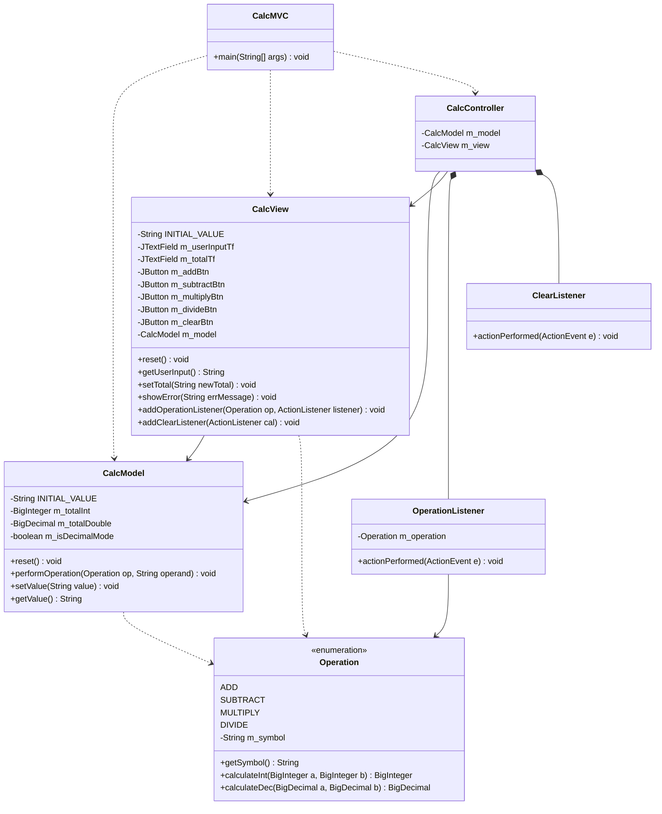

# PD3 - Calculadora MVC (BigInt y BigDouble)

Link del video: [PONER_LINK_AQUI]

## 1. Documentacion de lo implementado

En el codigo de base visto en clase, la calculadora usaba el patron MVC (Modelo Vista Controlador) pero tenia dos limites: solo hacia la multiplicacion y funcionaba unicamente con `BigInteger` (entonces si el usuario escribia un numero con punto decimal como `2.5`, el programa daba el error "Bad input").

Para cumplir con todos los requisitos, hice los siguientes cambios:

1. **Soporte para BIG int y BIG double en `CalcModel`:**
   - Agregué dos atributos en el modelo: `m_totalInt` (`BigInteger`) y `m_totalDouble` (`BigDecimal`), con un booleano `m_isDecimalMode`.
   - En el metodo `operar`, el programa revisa primero el `String` que entra. Si no tiene punto (`.`) ni notacion cientifica (`e`), hace el calculo con `BigInteger`. Si el usuario escribe un decimal (o si hace una division entre enteros que no cae justa, como `1 / 2`), `m_isDecimalMode` pasa a `true` y usamos `BigDecimal` con `MathContext.DECIMAL128` para tener una gran precision.
   - En `getValue()`, utilicé `stripTrailingZeros().toPlainString()` para limpiar los ceros inutiles al final del resultado.

2. **Incremento de las operaciones (Suma, Resta, Multiplicacion y Division):**
   - Agregué el archivo `Operacion.java` (un `enum` que aplica el patron Strategy) con las cuatro operaciones (`+`, `-`, `*`, `/`).
   - En `CalcView`, añadí los botones correspondientes para cada operacion.
   - En `CalcController`, creé una sola clase interna `OperationListener` que recibe la operacion a ejecutar y tambien atrapa el error `ArithmeticException` por si alguien intenta dividir por cero.

## 2. Estrategia para incrementar las operaciones: Command vs Strategy

Para agregar mas operaciones a la calculadora guardando el patron MVC, analizamos primero el patron de diseño **Command**, donde cada operacion es una clase independiente (`SumarCommand`, `RestarCommand`, etc.) que tiene un metodo `execute()`.

**Ventajas del patron Command:**

- Permite de hacer facilmente una funcion "Undo / Redo" (deshacer y rehacer), porque cada objeto Command puede guardar el total anterior antes de hacer el calculo.
- Permite guardar un historial o una cola de todas las operaciones hechas por el usuario.

**Desventajas del patron Command para nuestra calculadora:**

- Crea demasiadas clases para una calculadora simple que no necesita historial ni funcion de deshacer (sobre-ingenieria).
- Usa mas memoria: si guardamos muchos objetos Command en memoria con numeros `BigInteger` y `BigDecimal` muy grandes, gastamos memoria sin necesidad.
- No resuelve la repeticion de codigo dentro de `CalcModel`: si tenemos metodos separados (`sumar()`, `restar()`, `multiplicar()`), tendriamos que copiar y pegar el mismo bloque `if (!m_isDecimalMode ...)` en cada metodo para decidir entre `BigInteger` y `BigDecimal`.

**Estrategia implementada: Patron Strategy (`Operacion.java`)**
Como el patron Command no es conveniente aqui, implementé el patron **Strategy** usando el `enum Operacion`. Cada constante (`SUMA`, `RESTA`, `MULTIPLICACION`, `DIVISION`) define como calcular con `BigInteger` (`calcularInt`) y con `BigDecimal` (`calcularDec`).

**Ventajas de Strategy sobre Command:**

- **No repetimos codigo en el modelo:** `CalcModel` tiene un solo metodo `operar(Operacion op, String operand)` que hace la verificacion entre entero y decimal una sola vez, y luego llama a la estrategia.
- **Controlador mas limpio:** en lugar de escribir 4 clases `Listener` diferentes en `CalcController`, usamos un solo `OperationListener` que recibe la estrategia en un bucle `for`.
- **Mas ligero y facil de extender:** las estrategias no guardan estado en memoria. Si queremos agregar otra operacion como potencia o modulo, solo agregamos un bloque en `Operacion.java` y el boton en la vista.

## 3. Diagrama de clases UML

